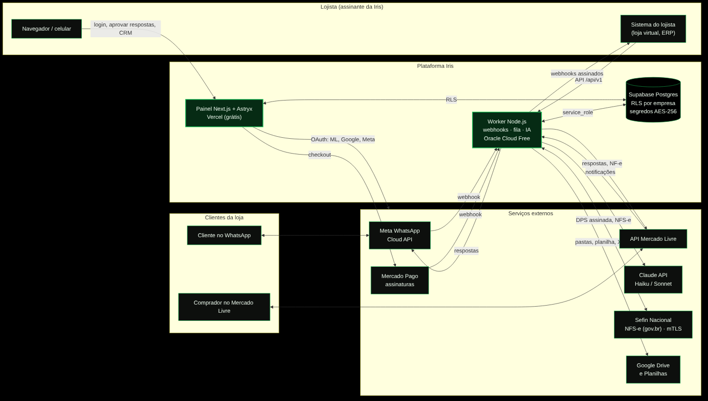

# Iris 🌈 — IA de vendas para lojistas (SaaS)

A Iris atende os clientes da loja no **WhatsApp** (API oficial da Meta) e no **Mercado Livre** com IA (Claude), organiza tudo num **CRM**, registra **vendas**, emite **nota fiscal** (NF-e pelo Faturador do Mercado Livre e NFS-e pela API oficial do governo) e mantém **pastas e planilhas de gestão no Google Drive** de cada cliente. Você vende a Iris por assinatura mensal (Mercado Pago).



## Módulos

| Módulo | O que faz | Onde está |
|---|---|---|
| **Painel** | Landing com planos, cadastro/login, início, conversas (aprovar respostas), CRM (funil), vendas e NF-e, notas de serviço (NFS-e), produtos, IA, integrações, assinatura | `apps/web` (Next.js 16 + React 19.2 + **Tailwind CSS 4**, tema preto e verde) |
| **Admin da plataforma** | Todos os clientes, MRR, uso da IA, trocar plano/status | `apps/web/src/app/admin` |
| **Worker** | Webhooks (Meta, ML, Mercado Pago), fila, IA, envios, NF-e (Faturador do ML), NFS-e Nacional, Google, API pública, webhooks de saída | `apps/worker` (Node 22, **sem dependências**) |
| **Banco** | Multiempresa com RLS, segredos criptografados (AES-256-GCM), fila, uso mensal | `supabase/migrations/0001_iris.sql` |
| **Compartilhado** | Criptografia, regras de envio (o que vai para aprovação), regras de plano | `packages/shared` |

### Canais e integrações
- **WhatsApp Cloud API**: cada cliente conecta o próprio número pelo **Cadastro Incorporado** da Meta (botão oficial). Não tem QR code nem automação de WhatsApp Web, que é o que leva a ban.
- **Mercado Livre**: OAuth por cliente; tópicos `questions`, `messages`, `orders_v2`, `shipments`, `items`, `claims`. Responde perguntas e pós-venda, importa pedidos e anúncios e avisa reclamações.
- **NF-e das vendas do ML**: emitida pelo **Faturador do Mercado Livre** via API (`POST /users/{id}/invoices/orders`), no modo manual (botão em Vendas) ou automático (venda paga). A Iris acompanha a autorização (tópico `invoices`), guarda a chave e salva o XML no Drive. No Full o ML emite sozinho.
- **NFS-e Nacional** (serviços): DPS em XML assinada com o certificado A1 (XMLDSig RSA-SHA256), enviada por mTLS à Sefin Nacional (`POST /nfse`), com consulta por DPS e cancelamento (evento e101101). Começa em produção restrita.
- **Produtos**: anúncios do ML entram sozinhos; também CSV em massa, cadastro um por um e API.
- **Google Drive** (escopo `drive.file`): cria `Iris — Empresa/` com as subpastas (Notas Fiscais/ano/mês, Vendas, Funcionários, Financeiro, Produtos, Fornecedores, Contratos, Relatórios, Marketing) e a planilha **Iris — Gestão** com as abas Painel, Vendas (com comissão), Produtos (margem e reposição), Clientes, Funcionários, Folha de Pagamento (FGTS automático), Folgas e Férias, Contas a Pagar, Contas a Receber, Fluxo de Caixa e Fornecedores. Cada venda ou cliente novo vira uma linha, e o XML de cada NF-e é salvo na pasta.
- **Claude**: Haiku nos planos básicos e Sonnet no Pro. Responde só com os dados do negócio, do catálogo e do anúncio.
- **API pública + webhooks**: o sistema do lojista envia vendas, contatos, produtos e mensagens, e recebe eventos assinados com HMAC.
- **Mercado Pago**: assinatura recorrente (preapproval), com webhook validado por `x-signature`.

### Segurança
- RLS em todas as tabelas. O painel **não consegue** alterar integrações, uso, plano ou status (isso só acontece no servidor).
- Tokens de ML, Meta e Google e o certificado A1 da NFS-e ficam **criptografados** e só o servidor lê.
- Webhooks validados (assinatura da Meta, `application_id` do ML e `x-signature` do MP). OAuth com `state` em cookie httpOnly.
- Proteção contra SSRF nos webhooks de saída. Chave da API guardada só como hash. Limite de requisições na API.
- A IA nunca promete reembolso, desconto ou troca, não passa contato no ML e ignora instruções escondidas na mensagem do cliente.

## Estrutura de custo (começando grátis)

| Peça | Serviço | Custo no começo |
|---|---|---|
| Painel | Vercel Hobby | grátis |
| Banco + login | Supabase Free (500 MB) | grátis |
| Worker (webhooks 24h) | Oracle Cloud Always Free (VM ARM) | grátis |
| WhatsApp | Meta Cloud API | responder ao cliente dentro de 24h costuma ser grátis; confira a tabela da Meta |
| Mercado Livre (inclui Faturador) / Google / NFS-e Nacional | APIs | grátis (certificado A1 ≈ R$ 150–250/ano) |
| IA | Claude API | ~US$ 0,0002 por resposta (Haiku); você embute no plano |
| Pagamentos | Mercado Pago | só a taxa por cobrança |

> O plano Hobby da Vercel é para uso não comercial. Quando começar a vender, passe para o Vercel Pro ou hospede o painel na mesma VM da Oracle.

Passo a passo de instalação: **[docs/DEPLOY.md](docs/DEPLOY.md)** · Diagramas: **[docs/ARQUITETURA.md](docs/ARQUITETURA.md)**

## Desenvolvimento

```bash
npm install                 # na raiz (workspaces)
npm test                    # testes do worker (23 cenários)
npm run dev:worker          # http://localhost:8080
npm run dev:web             # http://localhost:3000
```
