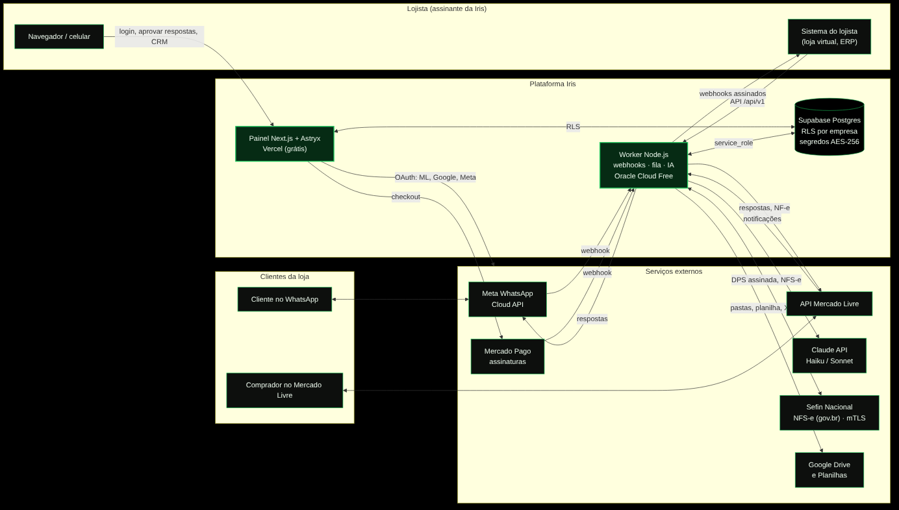
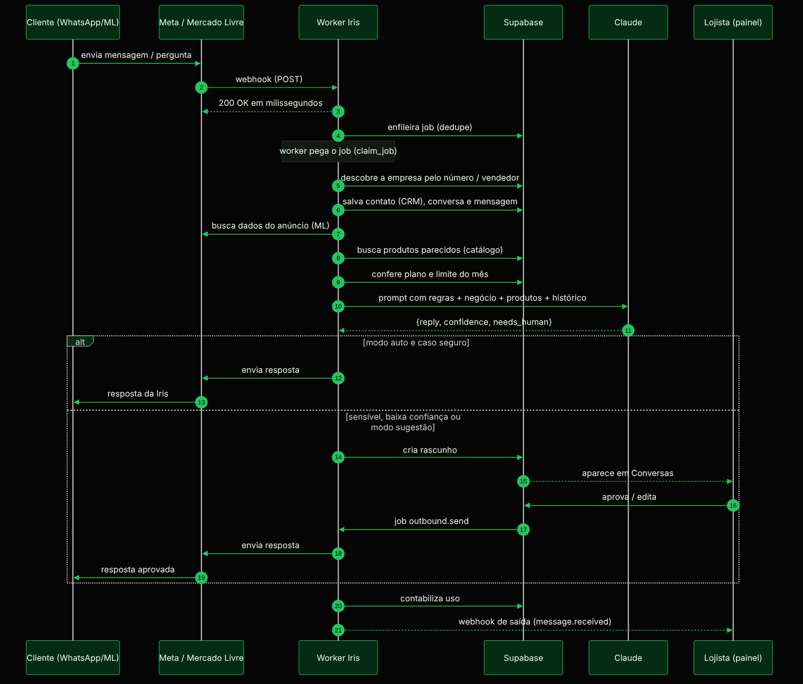
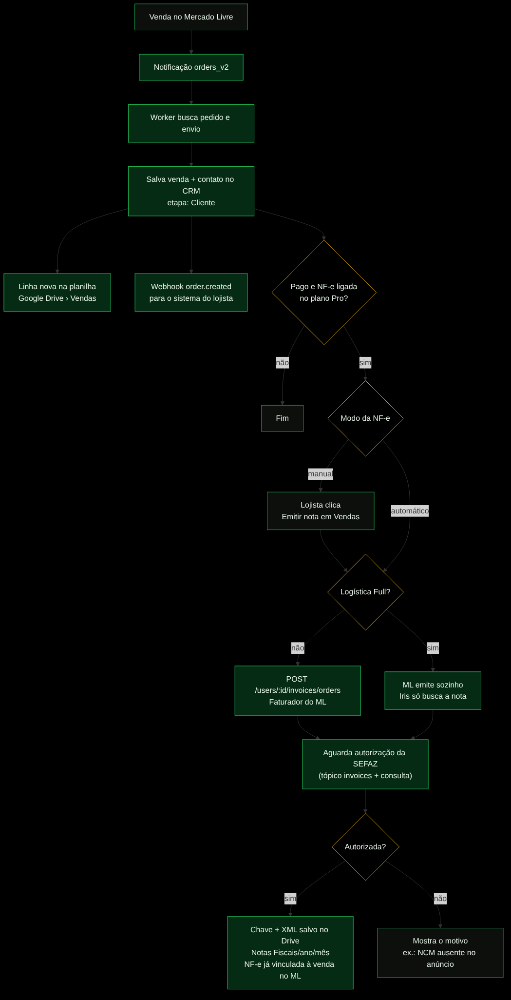
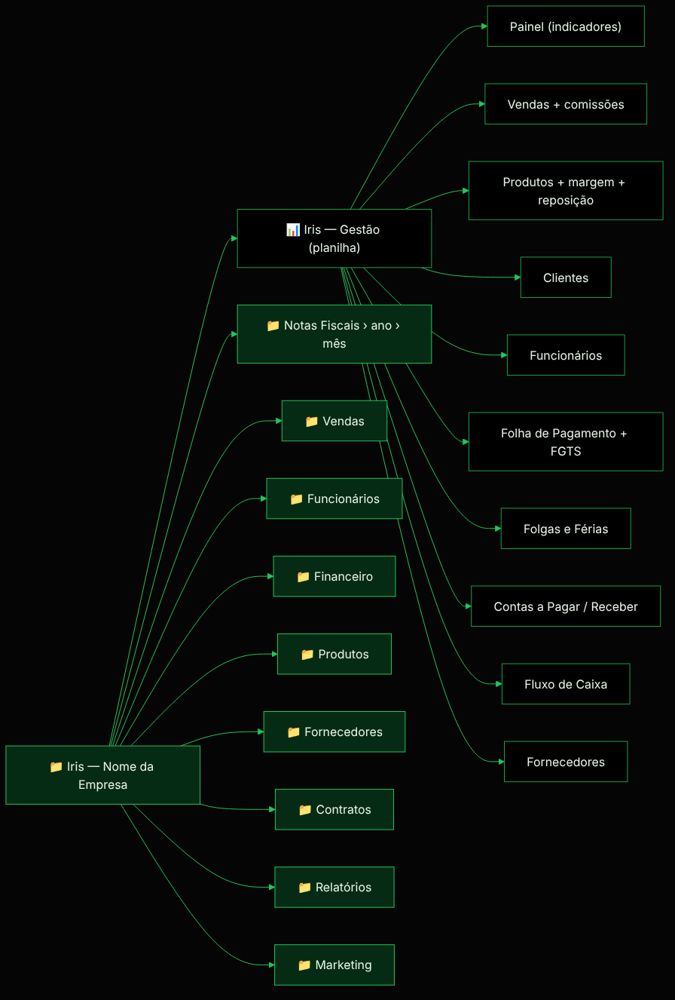
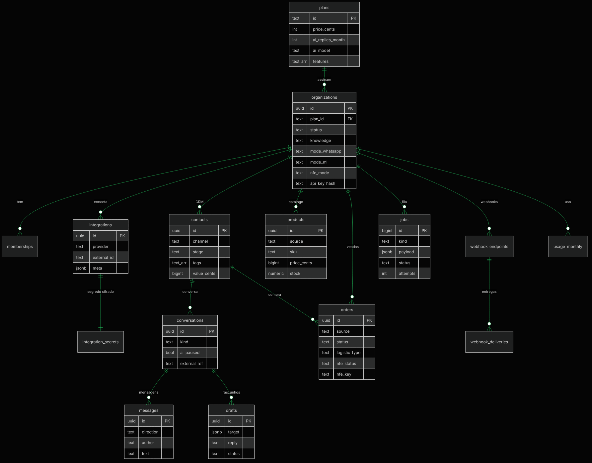

# Arquitetura da Iris

Os arquivos `.mmd` em `docs/diagramas/` são a fonte dos diagramas (Mermaid, que o GitHub desenha sozinho). As imagens `.png` foram geradas a partir deles.

## 1. Visão geral



- **Painel (apps/web)**: Next.js 16 + Tailwind CSS 4. Fala com o Supabase usando a sessão do usuário (RLS). Faz os logins OAuth (Mercado Livre, Google, Meta) e o checkout do Mercado Pago.
- **Worker (apps/worker)**: recebe todos os webhooks, responde 200 na hora e processa pela fila (`jobs` + `claim_job()` com `FOR UPDATE SKIP LOCKED`, que permite vários workers).
- **Supabase**: banco, login e RLS. A service_role fica só no worker e nas rotas de servidor.

## 2. Mensagem do cliente → resposta



Regras de envio (`packages/shared/src/policy.js`). Vão **sempre para aprovação**:
- modo sugestão;
- confiança menor que o mínimo;
- a IA pediu humano;
- assuntos sensíveis (reembolso, troca, cancelamento, desconto, pagamento, defeito, atraso, nota fiscal…);
- no ML, resposta com link, telefone, e-mail ou rede social.

## 3. Venda → nota fiscal



A NF-e de produto sai pelo **Faturador do Mercado Livre**: `POST /users/{id}/invoices/orders` com os pedidos (um carrinho = uma nota), consulta em `GET /users/{id}/invoices/{invoice_id}` (ou pelo pedido, `/invoices/orders/{order_id}`) e XML em `xml_location`. O tópico `invoices` avisa quando muda o status. Pré-requisitos: Faturador ativado na conta (certificado A1 enviado ao ML) e dados fiscais nos anúncios. Comece no modo **manual**.

### NFS-e Nacional (serviços)

1. Painel cria a nota (`service_invoices`, status `pending`) e o servidor enfileira `nfse.emit`.
2. Worker reserva o número da DPS, monta o XML na ordem do XSD (v1.01) e assina o `infDPS` (C14N, RSA-SHA256) com o certificado A1 convertido pelo `openssl`.
3. Envia por mTLS: `POST {Sefin}/nfse` com `dpsXmlGZipB64`. Sucesso → chave de acesso e `nfseXmlGZipB64` (XML salvo no banco e no Drive).
4. Reenvio seguro: antes de reenviar, `GET /dps/{id}` recupera a chave se a primeira tentativa chegou.
5. Cancelamento: evento `e101101` assinado em `POST /nfse/{chave}/eventos`.

Ambientes: produção restrita `sefin.producaorestrita.nfse.gov.br/SefinNacional`, produção `sefin.nfse.gov.br/SefinNacional`. O grupo IBS/CBS é opcional e configurável; **valide em produção restrita** com o seu contador antes de ligar produção.

## 4. Google Drive do cliente



Escopo `drive.file`: a Iris só acessa o que ela criou. A tela de consentimento fica simples e a verificação do Google é mais fácil do que com acesso ao Drive inteiro.

## 5. Banco de dados



## 6. Fila de jobs

| Job | Quem cria | O que faz |
|---|---|---|
| `wa.message` | webhook Meta | CRM + IA + resposta/rascunho |
| `ml.notification` | webhook ML | perguntas, mensagens, pedidos, envios, anúncios, reclamações |
| `outbound.send` | painel / API | envia rascunho aprovado ou mensagem manual |
| `nfe.process` | venda paga / botão | Faturador do ML → aguarda autorização → XML no Drive |
| `nfse.emit` / `nfse.cancel` | painel (via servidor) | DPS assinada → Sefin Nacional / evento de cancelamento |
| `google.setup` / `google.export` / `google.append` | OAuth / eventos | pastas, planilha e linhas novas |
| `webhook.dispatch` | eventos | POST assinado para o sistema do cliente |
| `mp.subscription` | webhook MP | ativa, pausa ou cancela o plano |

Tentativas: até 5, com espera de 30 s, 2 min, 8 min e 32 min. Erros permanentes (sem permissão, dados inválidos) param na hora.

## 7. API pública

```http
POST /api/v1/orders      { external_id, status, total, items:[{title,sku,quantity,price}], customer:{name,phone,email} }
POST /api/v1/messages    { to: "5515999999999", text }
POST /api/v1/contacts    { name, phone, email, stage, tags, notes }
POST /api/v1/products    { products: [{ sku, name, price, stock, description }] }   (até 500)
GET  /api/v1/orders?limit=50
Authorization: Bearer iris_xxxxxxxx_...
```

Webhooks de saída: `POST` com `X-Iris-Event` e `X-Iris-Signature: sha256=HMAC(corpo, segredo)`.
